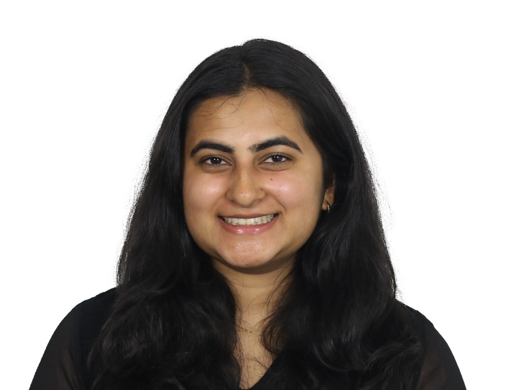
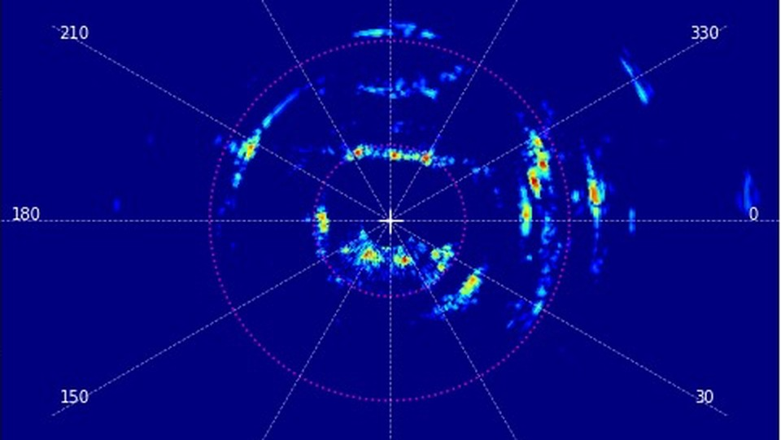
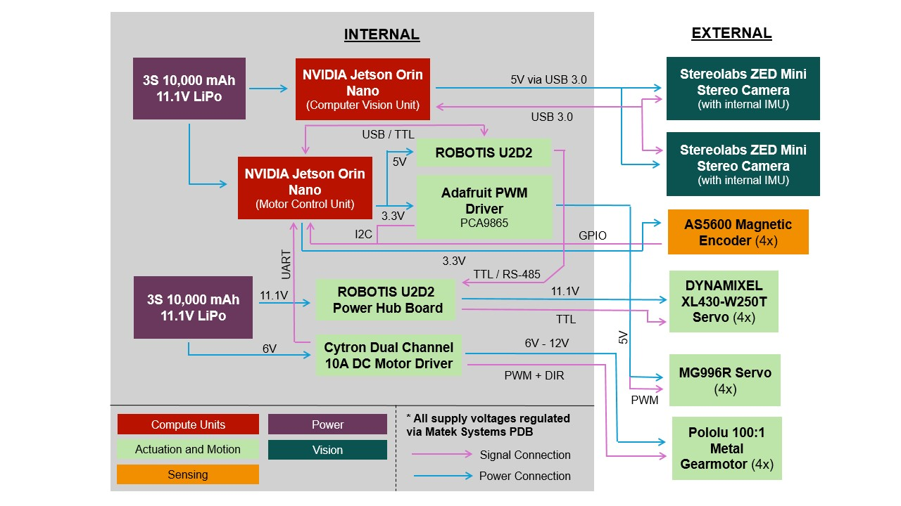
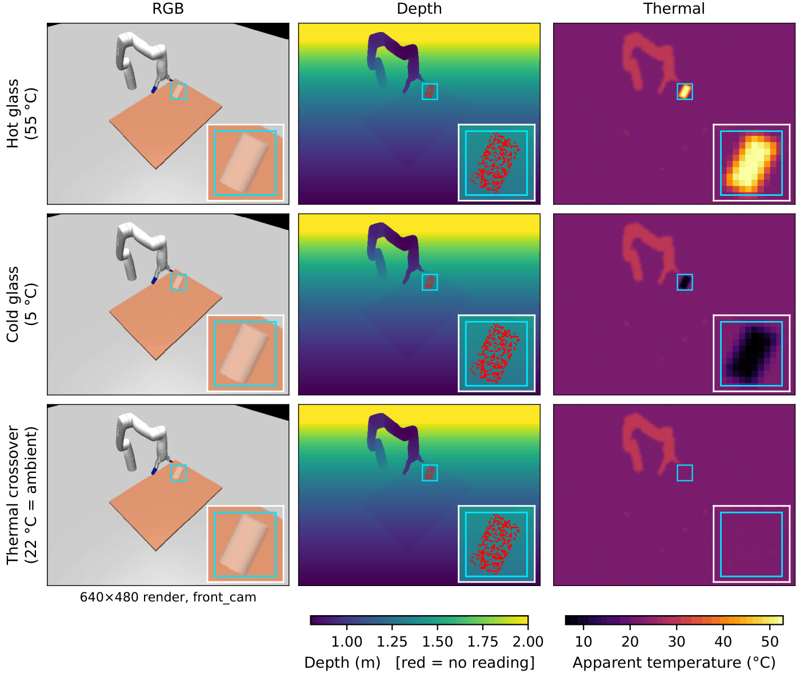



<section class="intro" aria-label="Introduction">

<h1>Sadhana Kumar</h1>

Robotics master's student (MRSD) at Carnegie Mellon, graduating May 2028. I work on perception and autonomy for robots in hard real-world settings: smoke-filled buildings, city sidewalks, lunar terrain.

Before CMU: BS in Mechanical Engineering with a minor in Robotics from Georgia Tech, where I did research in the Aerospace Robotics Lab.

<a href="mailto:sadhanak@andrew.cmu.edu">Email</a><a href="https://github.com/s-kumar72">GitHub</a><a href="https://www.linkedin.com/in/sadhana--kumar">LinkedIn</a>

</section>

<h2 class="section-title" id="projects">Projects</h2>

<h3><a href="/projects/#sidewalk-sidekick">Sidewalk Sidekick</a></h3>

Georgia Tech capstone · Spring 2026

A wheeled quadruped with LIDAR, RGB-D perception, and a shared-control handle that guides blind and visually impaired people around sidewalk obstacles.

Overall Honorable Mention out of 230+ teams

<a href="/projects/#sidewalk-sidekick">Details</a><a href="https://youtu.be/_x3aDHAftAU">Video</a>

<h3>Autonomous UAV for fire reconnaissance</h3>

CMU MRSD capstone · Fall 2026 to present

A drone that scouts smoke-filled, GPS-denied buildings before firefighters go in, using thermal and radar perception, collaborative SLAM, and a map-based GUI for fire command.

<h3><a href="/research/#nova">NOVA rover</a></h3>

Aerospace Robotics Lab, Georgia Tech · 2025 to 2026

A low-cost rover for multi-agent autonomy research. I led the build and designed the electrical system and chassis integration.

Released as open-source hardware

<a href="/research/#nova">Details</a><a href="https://github.com/AstroX-OpenRover/NOVA2">GitHub</a>

<h3><a href="https://github.com/s-kumar72/multimodal-transparent-object-manipulation">Seeing transparent objects</a></h3>

CMU Deep Learning (11-785) · Fall 2026 to present

Fusing RGB-D and thermal data so a robot can perceive and grasp glass cups and other transparent objects.

<a href="https://github.com/s-kumar72/multimodal-transparent-object-manipulation">GitHub</a>

Also: <a href="/projects/#flute-musician">a flute-playing robot</a>, <a href="/projects/#skin-lesion-detection-model">a skin lesion classifier</a>, and <a href="/research/#advanced-manufacturing-pilot-facility-ampf">Schlieren flow imaging</a>.

<h2 class="section-title" id="experience">Experience</h2>

<ul class="rows">
<li>Undergraduate Researcher · Aerospace Robotics Lab, Georgia Tech2025 – 2026</li>
<li>CAD Applications Engineering Intern · AppleSummer 2024</li>
<li>Undergraduate Research Assistant · Advanced Manufacturing Pilot Facility, Georgia Tech2023 – 2026</li>
<li>Process Design &amp; Development Intern · The Timken CompanySummer 2023</li>
<li>Software Engineering Intern · WP EngineSummer 2022</li>
</ul>

<h2 class="section-title" id="education">Education</h2>

<ul class="rows">
<li>MS, Robotic Systems Development · Carnegie Mellon University2026 – 2028</li>
<li>BS, Mechanical Engineering, minor in Robotics · Georgia Tech · Stamps President's Scholar2022 – 2026</li>
</ul>

<h2 class="section-title" id="skills">Skills</h2>

<dl class="skills">
<dt>Programming</dt>
<dd>Python, C++, ROS 2, MATLAB, Java, Arduino</dd>
<dt>Perception &amp; learning</dt>
<dd>PyTorch, computer vision, RGB-D, LiDAR, multimodal perception</dd>
<dt>Simulation</dt>
<dd>NVIDIA Isaac Sim / Omniverse, MuJoCo</dd>
<dt>CAD &amp; fabrication</dt>
<dd>SOLIDWORKS, Siemens NX / NX Open, Inventor, Teamcenter, 3D printing, waterjet, laser cutting</dd>
<dt>Embedded</dt>
<dd>STM32, I2C / UART, motor control</dd>
</dl>
