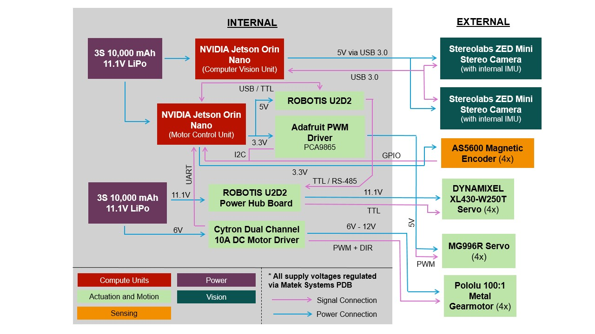
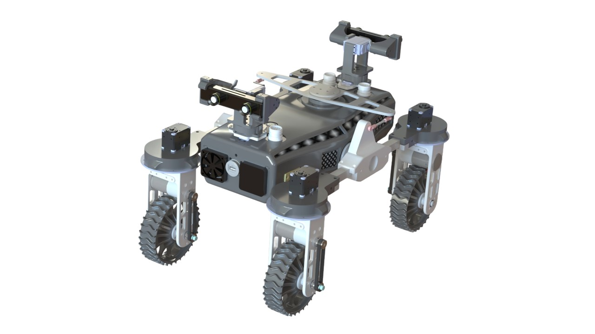



<ul class="jump">
<li><a href="#aerospace-robotics-lab-arl">Aerospace Robotics Lab</a></li>
<li><a href="#advanced-manufacturing-pilot-facility-ampf">Advanced Manufacturing Pilot Facility</a></li>
<li><a href="#posters">Posters</a></li>
<li><a href="#abstracts">Abstracts</a></li>
</ul>

## Aerospace Robotics Lab (ARL)

Undergraduate researcher, Georgia Tech, since Spring 2025. Advisor: Dr. Yashwanth Nakka

The Aerospace Robotics Lab researches aerospace systems that operate autonomously (safely, intelligently, and collaboratively) in uncertain and extreme environments. This includes multi-modal robotic systems for extreme terrain navigation, decision-making under uncertainty and safe exploration, and collaborative and multi-agent autonomy.

### NOVA: small-form-factor lunar rover platform {#nova}

I lead the effort to build a modular, 3D-printed lunar rover platform (Navigation, Operation, and Validation of Autonomy algorithms) that gives researchers an accessible testbed for multi-agent autonomy. I designed the electrical system and chassis integration, reviewed the mechanical design, and fabricated the rover.

Released as open-source hardware, October 2026

NOVA is a four-wheel rover with independently steered swerve modules on a differential-bar (rocker) chassis, built to test planetary autonomy on the lab's lunar-analog testbed. The full SolidWorks assembly (13 sub-assemblies, 56 parts), STEP files, bill of materials, and build guide are now public so other labs and student teams can rebuild, modify, and extend it.

**Highlights**

- Four swerve modules: 100:1 gearmotors for drive, Dynamixel XL430 servos for steering
- NVIDIA Jetson Orin Nano for perception with a ZED 2i stereo camera; Raspberry Pi Pico 2W for motor control and the BNO055 IMU
- 3S 10 Ah LiPo power system with a Matek power distribution board
- Structure of 3D-printed PLA, 6061 aluminum plate, and aluminum tube

<a class="btn-link" href="https://aerospaceroboticslab.github.io/nova.html">Project page</a> <a class="btn-link" href="https://github.com/AstroX-OpenRover/NOVA2">GitHub repo</a> <a class="btn-link" href="https://lnkd.in/p/gNNJXiXk">Announcement</a>

<figure>

<figcaption>NOVA overview</figcaption>
</figure>
<figure>

<figcaption>Electrical system and integration</figcaption>
</figure>

---

## Advanced Manufacturing Pilot Facility (AMPF)

Undergraduate research assistant, Georgia Tech, since Spring 2023. Advisors: Dr. Zachary Brunson and Dr. Aaron Stebner

The AMPF is a 20,000-square-foot, reconfigurable research and development high-bay that bridges the gap between laboratory research and real-world manufacturing deployment. It also serves as a teaching laboratory and workforce development hub for academic research, industry collaborations, and training programs.

### Schlieren imaging for gas flow visualization in the Optomec DED printer

Schlieren photography visualizes changes in fluid density through light refraction. This project aimed to characterize the unknown, system-agnostic mass flow pattern and source behind the high variability and periodicity in mass flow among nominal DED printers. I designed the system integration with the Optomec DED and managed the project so that in-situ and ex-situ testing met the timeline requirements.

<a class="btn-link" href="/files/Schlieren_Poster.pdf">Poster (PDF)</a>

### Alternative sealing methods for density testing of porous additively manufactured parts

An independent project funded by the Georgia Tech President's Undergraduate Research Award. Additively manufactured parts are inherently porous, so they need oil impregnation for 1+ hours before their density can be measured with the Archimedes method, which is inefficient for large batches. I am testing alternative sealing methods, including vacuum sealing, heat shrink, and IPA impregnation.

<a class="btn-link" href="/files/Density_Testing_Whitepaper.pdf">Whitepaper (PDF)</a>

---

## Posters



- **{{ item.title }}** ({{ item.venue }}, {{ item.date | date: "%Y" }})  
  [PDF]({{ item.pdf }})


## Abstracts



- **{{ item.title }}** ({{ item.venue }}, {{ item.date | date: "%Y" }})  
  [PDF]({{ item.pdf }})

